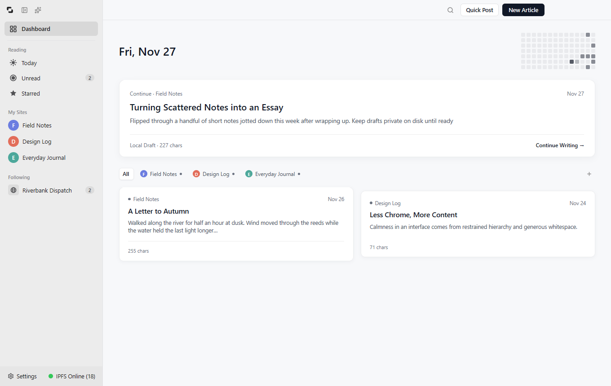
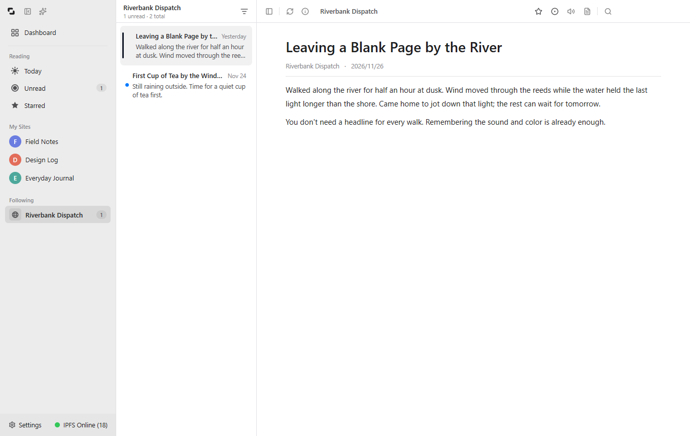
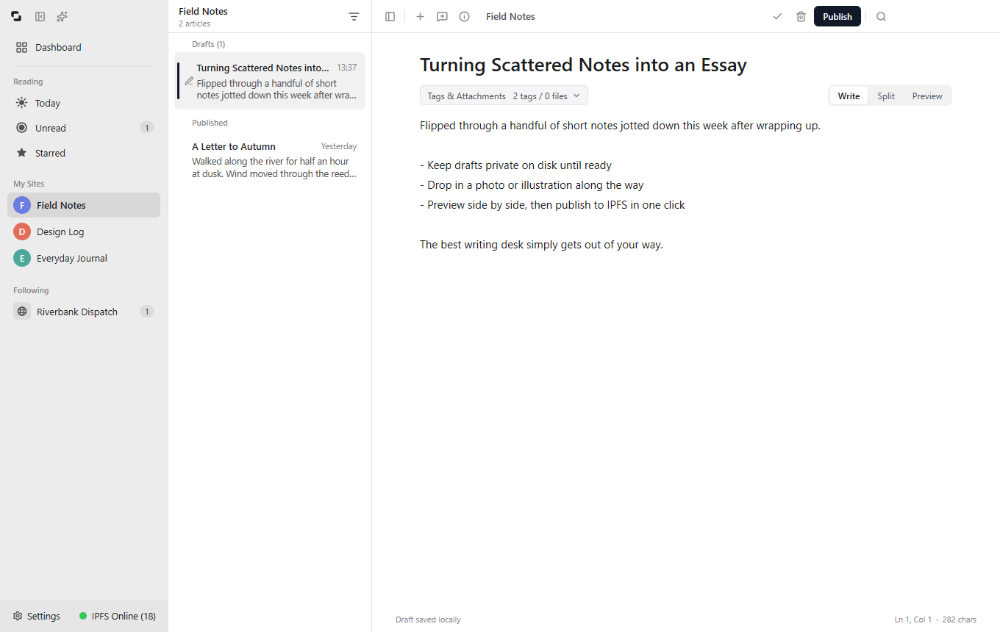
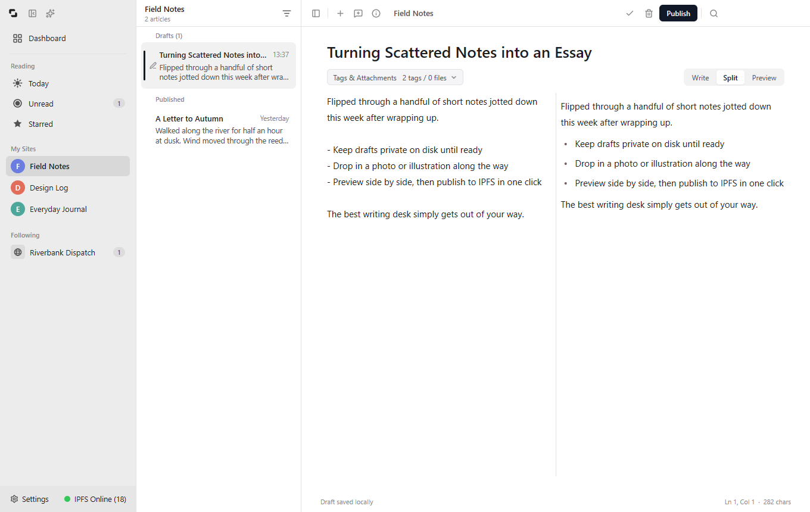
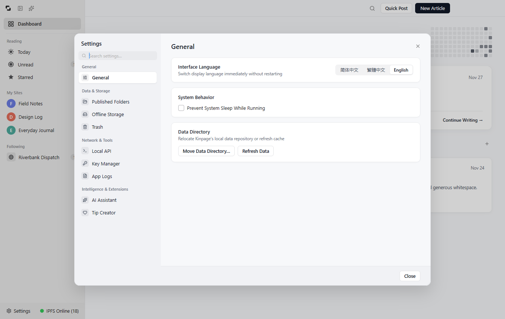

<div align="center">

<a href="docs/branding/README.md">
  <picture>
    <source media="(prefers-color-scheme: dark)" srcset="docs/branding/kinpage-horizontal-reversed.svg">
    
  </picture>
</a>

<h3>Decentralized blogging, IPFS publishing, and feed reading — built natively for Windows.</h3>

<p>
  <a href="https://github.com/puremixlab/kinpage/releases"></a>
  <a href="https://github.com/puremixlab/kinpage/actions/workflows/windows-ci.yml"></a>
  
  <a href="LICENSE"></a>
  <a href="https://awesomemygo.dev/apps/planet-windows"></a>
</p>

<p>
  <strong>English</strong> ·
  <a href="README_zh.md">简体中文</a> ·
  <a href="#download">Download</a> ·
  <a href="#features">Features</a> ·
  <a href="#screenshots">Screenshots</a> ·
  <a href="#build-from-source">Build from Source</a> ·
  <a href="windows/README.md">Full User Guide (中文)</a>
</p>

<br />

<picture>
  <source media="(prefers-color-scheme: dark)" srcset="docs/screenshots/en/workspace-dashboard-dark.png">
  
</picture>

<p><sub><strong>Kinpage (邻页)</strong> — an independent Windows native app derived from <a href="https://github.com/Planetable/Planet">Planetable/Planet</a> for macOS, built with MyGo Native UI.</sub></p>

</div>

---

## Features

<table>
  <tr>
    <td width="50%" valign="top">
      <strong>Native macOS-Style Writing Desk</strong><br />
      Three-column MyGo Native UI with a Sequoia Letterpress Writing Desk (<em>写作台</em>) pinned at the top of the sidebar: editorial date masthead, compact 14-week activity heatmap, elevated manuscript draft sheet, 3:2 article cards, Quick Post with media attachments, Markdown split editor, custom publish dates, cross-site article moves, portable <code>.article.zip</code> import/export, site archiving, and <code>podcast.xml</code> generation.
    </td>
    <td width="50%" valign="top">
      <strong>Built-In IPFS, IPNS &amp; Local API</strong><br />
      Bundles Kubo for automatic IPNS publishing, background renewal, Quick vs. Full rebuilds, <code>Ctrl+O</code> Open IPFS Resource (CID, IPNS, <code>.eth</code>/<code>.sol</code>/<code>.bit</code>/<code>.fc</code>), live traffic &amp; <code>/p2p-circuit</code> diagnostics, configurable public gateways, plus macOS Planet Local API (<code>/v0/id</code>, <code>/public/*</code> static previews, and built-in <code>/app/</code> Web Client).
    </td>
  </tr>
  <tr>
    <td width="50%" valign="top">
      <strong>Feed, ENS &amp; Offline Reader</strong><br />
      Follow RSS, Atom, JSON Feed, website homepages with feed auto-discovery, IPNS names, and ENSIP-15 <code>.eth</code> sites. Organize reading with Smart Feeds (<em>Today</em>, <em>Unread</em>, <em>Favorites</em>) and 6 star types, interactive GFM To-Do checkboxes, privacy-enhanced YouTube embeds, sandboxed original webpage toggle, hybrid BM25 + semantic search, TTS narration, and offline media pinning.
    </td>
    <td width="50%" valign="top">
      <strong>Templates, Backups, Web3 &amp; Integrations</strong><br />
      Ships with 5 upstream templates (<em>Plain</em>, <em>8-bit</em>, <em>Grid</em>, <em>Platinum</em>, <em>Sepia</em>) with sandboxed in-app preview, static HTML export, <code>.planet</code> backup import/export, and custom repository relocation. Integrates Cloudflare Pages, SSH/rsync, Pinnable, Filebase, <code>dWebServices.xyz</code>, Farcaster <code>.well-known/farcaster.json</code>, EIP-681 ETH creator tipping, Plausible, Telegram, and X sync.
    </td>
  </tr>
</table>

## Screenshots

<table>
  <tr>
    <td width="50%" align="center" valign="top">
      <picture>
        <source media="(prefers-color-scheme: dark)" srcset="docs/screenshots/en/subscription-reader-dark.png">
        
      </picture>
      <br />
      <sub><strong>Three-Column Reader</strong> — Subscriptions, article list, and rich Markdown reading view.</sub>
    </td>
    <td width="50%" align="center" valign="top">
      <picture>
        <source media="(prefers-color-scheme: dark)" srcset="docs/screenshots/en/writing-editor-dark.png">
        
      </picture>
      <br />
      <sub><strong>Markdown Editor</strong> — Distraction-free authoring with local drafts and explicit publish actions.</sub>
    </td>
  </tr>
  <tr>
    <td width="50%" align="center" valign="top">
      <picture>
        <source media="(prefers-color-scheme: dark)" srcset="docs/screenshots/en/writing-metadata-dark.png">
        
      </picture>
      <br />
      <sub><strong>Tags, Attachments &amp; Split View</strong> — Manage article metadata and preview Markdown side by side.</sub>
    </td>
    <td width="50%" align="center" valign="top">
      <picture>
        <source media="(prefers-color-scheme: dark)" srcset="docs/screenshots/en/settings-dark.png">
        
      </picture>
      <br />
      <sub><strong>Layered Settings &amp; Multi-Language</strong> — Switch between English, Simplified Chinese, and Traditional Chinese instantly.</sub>
    </td>
  </tr>
</table>

## Download

| Build | Platform | Requirements | Checksums & Notes |
| --- | --- | --- | --- |
| **[Kinpage v0.1.0](https://github.com/puremixlab/kinpage/releases/tag/v0.1.0)** | Windows x64 | Windows 10/11 + WebView2 Runtime | [Release page](https://github.com/puremixlab/kinpage/releases) (MSIX / NSIS installer, SHA-256, source archive) |

Install via Microsoft Store (MSIX) or extract/install the Windows x64 setup into an empty directory, then launch **Kinpage** from the Start menu. See [MSIX Packaging Guide](windows/docs/msix-packaging.md) for Store and sideloading builds.

> [!NOTE]
> **Unsigned release candidate.** Windows SmartScreen may prompt when running the installer — verify the published SHA-256 checksum on the release page before installing. Native desktop GUI, IME, cross-version upgrade, and macOS `.planet` round-trip compatibility remain under verification. See [known limitations](windows/README.md#尚未完成与待验证) and the [rc.1 acceptance scope](docs/acceptance-0.0.1-rc.1.md).

> [!WARNING]
> Exported `.planet` backups contain **unencrypted IPNS private keys**. Keep backup archives private and stored safely.

## Quick Start

- **Follow a site:** Click **Settings** at the bottom-left of the sidebar and choose **Follow Site…**, enter a website URL (such as `https://olivida.eth.limo`), an RSS/Atom/JSON Feed URL, an IPNS address, or an ENS `.eth` name, then click **Follow**.
- **Create & publish a site:** Click **New Article** (or **Settings → New Site…**) to create a site and start a Markdown draft. Drafts stay local-only until you click **Publish**, which queues public IPFS/IPNS publication of the site and its saved attachments.
- **Keyboard shortcuts:** `Ctrl+N` new article, `Ctrl+D` quick post, `Ctrl+E` edit current article, `Ctrl+F` toggle list search, `Ctrl+O` open IPFS/IPNS/ENS resource, `Ctrl+,` open Settings.

> Kinpage supports **English**, **Simplified Chinese**, and **Traditional Chinese** — switch languages anytime from **Settings** without restarting. Step-by-step guides for writing, publishing, offline pinning, and service integrations are available in the [full Chinese user guide](windows/README.md).

## Build from Source

**Prerequisites:** Windows x64, Git, [Go 1.27.4](https://go.dev/dl/) (or compatible toolchain), [Bun](https://bun.sh/), WebView2 Runtime, and [7-Zip](https://www.7-zip.org/) (only required for installer packaging).

```powershell
git clone https://github.com/puremixlab/kinpage.git
cd kinpage/windows
bun install --frozen-lockfile
powershell -NoProfile -File scripts/prepare-kubo.ps1
bun run dev
```

### Common Commands

Run all commands from `windows/`:

| Command | Purpose |
| --- | --- |
| `bun run dev` | Start the Native UI desktop app in development mode |
| `bun run check` | Run full quality checks: docs, `gofmt`, `go vet`, tooling/release tests, Go tests |
| `bun run check:docs` | Lightweight check for [documentation-only changes](docs/git-workflow.md#纯文档检查) (Git + Bun only) |
| `bun run security:check` | Run dependency vulnerability audit (requires network access) |
| `bun run build` | Package the desktop app and installer into `windows/build/windows-amd64/` (close Kinpage/Kubo first) |

## Tech Stack

- **Desktop UI & runtime:** [MyGo](https://github.com/egoist/mygo) (`v0.10.0`) + [lobe-mygo](https://github.com/lobehub/lobe-mygo) Native UI, with sandboxed Windows WebView2 (only for template previews and subscription original webpage viewing)
- **Backend & IPFS:** Go + bundled [Kubo](https://github.com/ipfs/kubo)
- **Tooling & release scripts:** Bun + PowerShell

## Documentation & Support

- [简体中文主页](README_zh.md) · [完整使用指南](windows/README.md) — daily usage, settings, integrations, and compatibility details.
- [Upgrade & Recovery](windows/docs/safe-upgrade.md) — installation, upgrade, and recovery procedures.
- [Changelog](CHANGELOG.md) — version history and unreleased changes.
- [Logo & Branding](docs/branding/README.md) — brand guidelines and SVG assets.
- [Contributing](CONTRIBUTING.md) · [Git Workflow](docs/git-workflow.md) · [Releasing](docs/releasing.md) — development and release workflows.
- [Security Policy](SECURITY.md) · [Privacy Policy](PRIVACY.md) · [Issues](https://github.com/puremixlab/kinpage/issues) — vulnerability reporting, privacy details, bugs, and feature requests.

## Acknowledgements

Kinpage (邻页) is an independent Windows native app inspired by and derived from [Planetable/Planet](https://github.com/Planetable/Planet). Built with [MyGo](https://github.com/egoist/mygo) and [IPFS Kubo](https://github.com/ipfs/kubo).

## License

Licensed under the [MIT License](LICENSE). Original Planet copyright notices are retained; third-party dependencies and bundled components are listed in [NOTICE.md](NOTICE.md).
