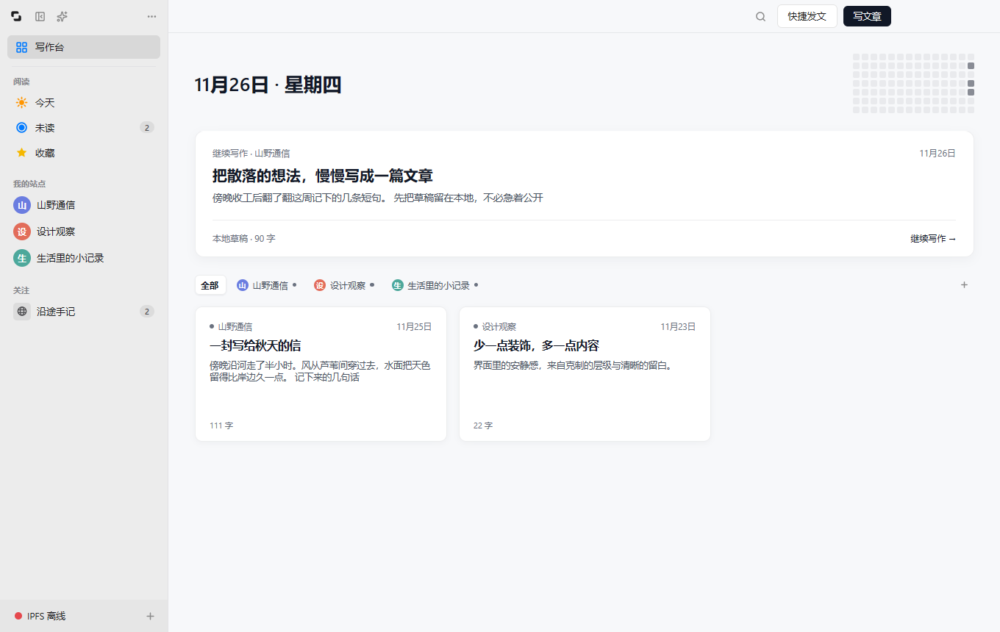
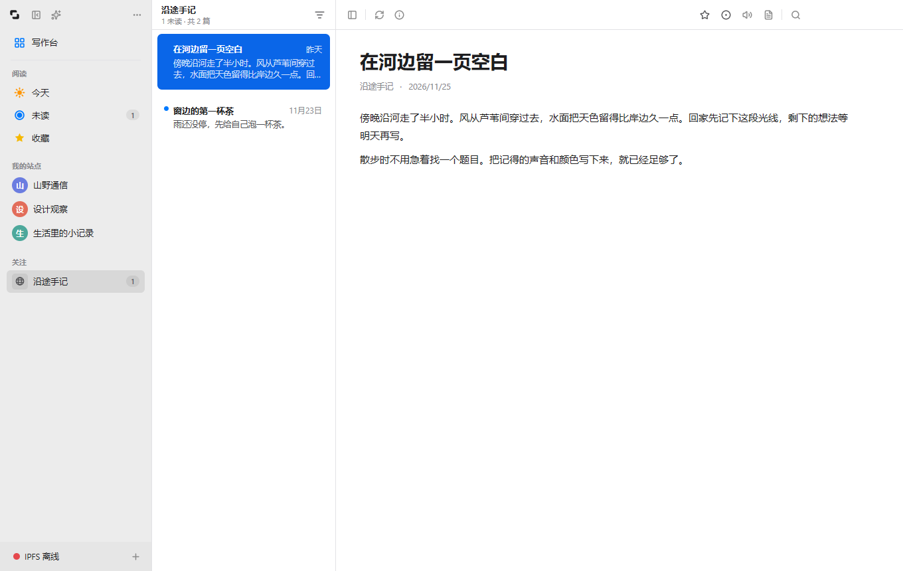
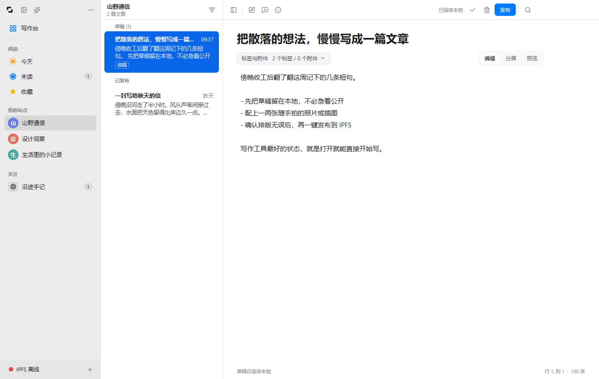
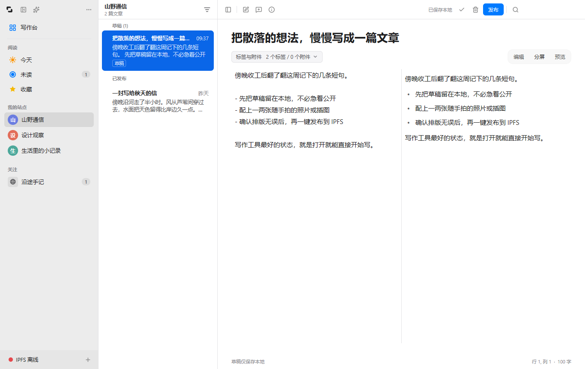
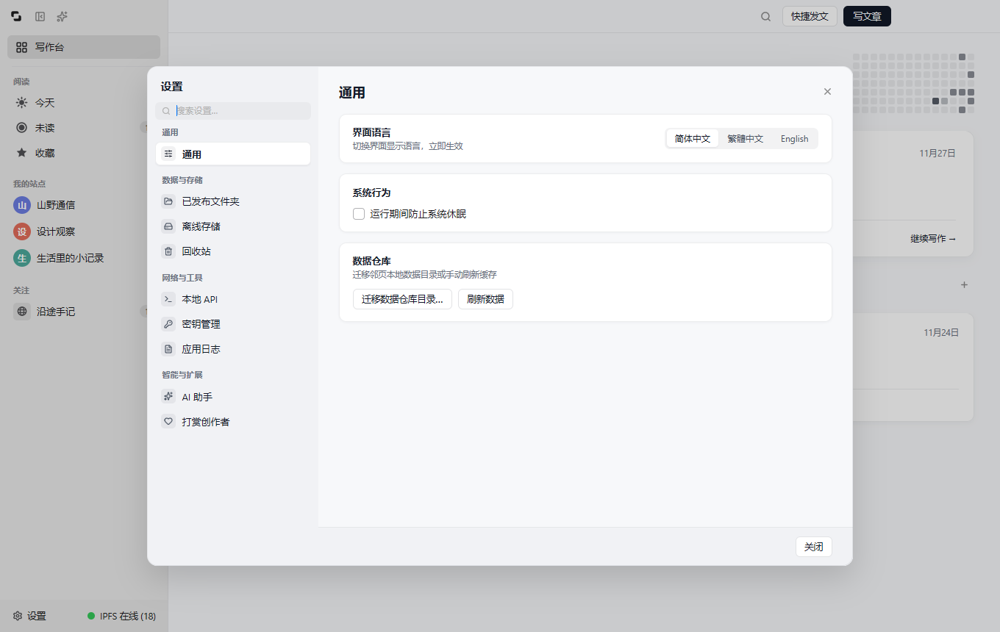

<div align="center">

<a href="docs/branding/README.md">
  <picture>
    <source media="(prefers-color-scheme: dark)" srcset="docs/branding/kinpage-horizontal-reversed.svg">
    
  </picture>
</a>

<h3>面向 Windows 的去中心化博客写作、IPFS 发布与订阅阅读桌面应用。</h3>

<p>
  <a href="https://github.com/puremixlab/kinpage/releases"></a>
  <a href="https://github.com/puremixlab/kinpage/actions/workflows/windows-ci.yml"></a>
  
  <a href="LICENSE"></a>
  <a href="https://awesomemygo.dev/apps/planet-windows"></a>
</p>

<p>
  <a href="README.md">English</a> ·
  <strong>简体中文</strong> ·
  <a href="#下载安装">下载安装</a> ·
  <a href="#核心特性">核心特性</a> ·
  <a href="#界面预览">界面预览</a> ·
  <a href="#从源码运行">从源码运行</a> ·
  <a href="windows/README.md">完整使用指南</a>
</p>

<br />

<picture>
  <source media="(prefers-color-scheme: dark)" srcset="docs/screenshots/workspace-dashboard-dark.png">
  
</picture>

<p><sub><strong>邻页 · Kinpage</strong> — 基于 macOS 原版 <a href="https://github.com/Planetable/Planet">Planetable/Planet</a> 独立开发的 Windows 原生桌面应用，采用 MyGo 原生界面构建。</sub></p>

</div>

---

## 核心特性

<table>
  <tr>
    <td width="50%" valign="top">
      <strong>原生 macOS 风格写作台与内容管理</strong><br />
      三栏 MyGo 原生界面，侧栏置顶 Sequoia 活版印纸风格<strong>写作台</strong>（日期刊头、14 周紧凑热力条、抬升草稿纸面与 3:2 文章卡片）；支持专注 Markdown 分栏编辑、快捷发文、自定义发布日期、跨站点移动文章、<code>.article.zip</code> 单篇导入导出、站点归档、附件媒体与 <code>podcast.xml</code> 播客生成。
    </td>
    <td width="50%" valign="top">
      <strong>内置 IPFS / IPNS 节点与本地 API</strong><br />
      随包内置 Kubo 节点，支持自动发布、后台 IPNS 续期、快速/完整重建、<code>Ctrl+O</code> 打开 IPFS 资源（CID / IPNS / <code>.eth</code> / <code>.sol</code> / <code>.bit</code> / <code>.fc</code>）、实时流量与中继诊断、可切换公共网关，以及对齐原版的 Local API（<code>/v0/id</code>、<code>/public/*</code> 静态预览与内置 <code>/app/</code> Web 客户端）。
    </td>
  </tr>
  <tr>
    <td width="50%" valign="top">
      <strong>订阅、ENS 与离线阅读</strong><br />
      支持 RSS、Atom、JSON Feed、网站首页自动发现、IPNS 与 ENSIP-15 <code>.eth</code> 站点；提供「今天 / 未读 / 收藏」智能视图与 6 类多类型星标、可交互待办清单、隐私增强 YouTube 嵌入、沙箱原网页切换、BM25 + 语义混合检索、语音朗读及离线固定阅读。
    </td>
    <td width="50%" valign="top">
      <strong>原版模板、备份、Web3 与外部集成</strong><br />
      内置 5 套原版模板（<em>Plain</em>、<em>8-bit</em>、<em>Grid</em>、<em>Platinum</em>、<em>Sepia</em>）及沙箱内嵌预览；支持静态 HTML 导出、<code>.planet</code> 备份导入导出与数据仓库迁移；集成 Cloudflare Pages、SSH/rsync、Pinnable、Filebase、<code>dWebServices.xyz</code>、Farcaster <code>.well-known/farcaster.json</code>、EIP-681 ETH 打赏、Plausible、Telegram 与 X 同步。
    </td>
  </tr>
</table>

## 界面预览

<table>
  <tr>
    <td width="50%" align="center" valign="top">
      <picture>
        <source media="(prefers-color-scheme: dark)" srcset="docs/screenshots/subscription-reader-dark.png">
        
      </picture>
      <br />
      <sub><strong>三栏订阅阅读</strong> — 订阅导航、文章列表与原生图文阅读视图。</sub>
    </td>
    <td width="50%" align="center" valign="top">
      <picture>
        <source media="(prefers-color-scheme: dark)" srcset="docs/screenshots/writing-editor-dark.png">
        
      </picture>
      <br />
      <sub><strong>Markdown 编辑器</strong> — 专注写作，清晰区分本地私有草稿与公开发布。</sub>
    </td>
  </tr>
  <tr>
    <td width="50%" align="center" valign="top">
      <picture>
        <source media="(prefers-color-scheme: dark)" srcset="docs/screenshots/writing-metadata-dark.png">
        
      </picture>
      <br />
      <sub><strong>标签、附件与分栏预览</strong> — 在编辑区原地管理文章元数据并实时分栏预览。</sub>
    </td>
    <td width="50%" align="center" valign="top">
      <picture>
        <source media="(prefers-color-scheme: dark)" srcset="docs/screenshots/settings-dark.png">
        
      </picture>
      <br />
      <sub><strong>分层设置与多语言</strong> — 支持简体中文、繁體中文与 English 即时切换，集中管理本地 API、密钥与 AI 助手。</sub>
    </td>
  </tr>
</table>

## 下载安装

| 版本 | 适用平台 | 运行环境 | 校验与说明 |
| --- | --- | --- | --- |
| **[邻页 · Kinpage v0.1.0](https://github.com/puremixlab/kinpage/releases/tag/v0.1.0)** | Windows x64 | Windows 10/11 + WebView2 Runtime | [Release 页面](https://github.com/puremixlab/kinpage/releases)（支持 Microsoft Store MSIX / 独立 NSIS 安装包、SHA-256 与源码归档） |

可通过 Microsoft Store（MSIX）安装，或将独立安装包安装到空目录后，从开始菜单打开 **Kinpage** 即可使用。商店打包与侧载说明见 [MSIX 打包文档](windows/docs/msix-packaging.md)。

> [!NOTE]
> **未签名 RC 预发布版本。** 运行安装包时 Windows SmartScreen 可能会给出提示，安装前建议核对 Release 页面提供的 SHA-256 校验值。完整桌面界面、输入法、跨版本升级及真实 Mac `.planet` 备份双向兼容仍在持续验证中，详见[已知限制](windows/README.md#尚未完成与待验证)与 [rc.1 验收范围](docs/acceptance-0.0.1-rc.1.md)。

> [!WARNING]
> 导出的 `.planet` 备份包含**未加密的 IPNS 私钥**，请妥善保管，切勿上传到公开仓库或网盘。

## 快速上手

- **订阅站点**：点击侧栏左下角的 **设置** 并选择 **关注订阅…**，输入网站首页（例如 `https://olivida.eth.limo`）、RSS / Atom / JSON Feed 地址、IPNS 地址或 `.eth` 域名，点击 **关注** 即可开始阅读。
- **创建并发布站点**：点击右上角 **写文章**（或 **设置 → 新建站点…**）新建站点并撰写 Markdown 草稿。草稿默认仅保存在本机，点击工具栏 **发布** 会将整个站点及已保存附件公开发布到 IPFS / IPNS。
- **常用快捷键**：`Ctrl+N` 新建文章、`Ctrl+D` 快捷发文、`Ctrl+E` 编辑当前文章、`Ctrl+F` 切换列表搜索、`Ctrl+O` 打开 IPFS / IPNS / ENS 资源、`Ctrl+,` 打开设置。

详细功能说明、离线固定与各项第三方服务配置请参阅[完整使用指南](windows/README.md)。

## 从源码运行

iOS 和 Android 手机端位于 `mobile/`。构建与桌面协同发布步骤见[移动版指南](mobile/README.md)。

**环境准备**：Windows x64、Git、[Go 1.27.4](https://go.dev/dl/)（或兼容工具链）、[Bun](https://bun.sh/)、WebView2 Runtime；如需打包安装程序还需安装 [7-Zip](https://www.7-zip.org/)。

```powershell
git clone https://github.com/puremixlab/kinpage.git
cd kinpage/windows
bun install --frozen-lockfile
powershell -NoProfile -File scripts/prepare-kubo.ps1
bun run dev
```

### 常用开发命令

以下命令均在 `windows/` 目录执行：

| 命令 | 说明 |
| --- | --- |
| `bun run dev` | 启动 Native UI 桌面应用开发环境 |
| `bun run check` | 运行完整质量检查：文档、Go 格式、`go vet`、工具与发布脚本测试、Go 测试 |
| `bun run check:docs` | 仅修改[文档白名单](docs/git-workflow.md#纯文档检查)时的轻量检查（仅需 Git 和 Bun） |
| `bun run security:check` | 运行依赖漏洞安全扫描（需联网） |
| `bun run build` | 构建程序与独立安装包，输出到 `windows/build/windows-amd64/`（构建前先关闭 Kinpage/Kubo） |

## 技术栈

- **桌面界面与壳层**：[MyGo](https://github.com/egoist/mygo)（`v0.10.0`）+ [lobe-mygo](https://github.com/lobehub/lobe-mygo) Native UI，配合沙箱 Windows WebView2（仅用于模板预览与订阅原文网页）
- **后端与 IPFS**：Go + 内置 [Kubo](https://github.com/ipfs/kubo)
- **工具链与发布脚本**：Bun + PowerShell

## 文档与支持

- [English README](README.md) · [完整使用指南](windows/README.md) — 日常操作、站点设置、服务集成与兼容性说明。
- [升级与恢复指南](windows/docs/safe-upgrade.md) — 安装、升级与异常恢复流程。
- [更新日志](CHANGELOG.md) — 各版本变更与未发布改动记录。
- [Logo 与品牌规范](docs/branding/README.md) — 品牌视觉说明与矢量素材。
- [贡献指南](CONTRIBUTING.md) · [Git 协作指南](docs/git-workflow.md) · [发布流程](docs/releasing.md) — 开发协作与发版规范。
- [安全政策](SECURITY.md) · [隐私政策](PRIVACY.md) · [GitHub Issues](https://github.com/puremixlab/kinpage/issues) — 漏洞反馈、隐私说明、缺陷提交与功能建议。

## 致谢

邻页（Kinpage）是基于 [Planetable/Planet](https://github.com/Planetable/Planet) 独立开发的 Windows 移植版本，感谢上游项目以及 [MyGo](https://github.com/egoist/mygo) 和 [IPFS Kubo](https://github.com/ipfs/kubo) 社区。

## 许可证

采用 [MIT 许可证](LICENSE)。保留原版 Planet 版权声明；第三方依赖与随包组件许可证见 [NOTICE.md](NOTICE.md)。
